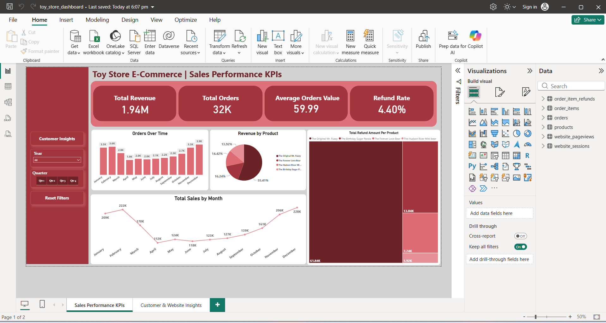
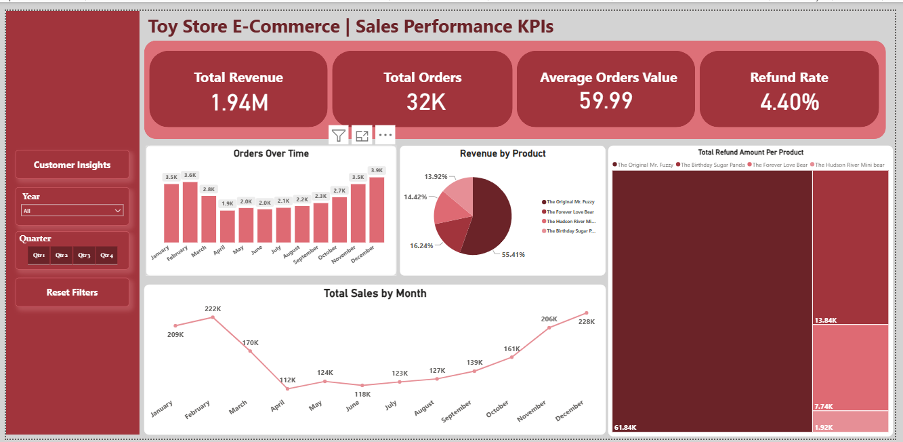

# Toy-Store-E-Commerce-Power-BI-Dashboard
Interactive Power BI dashboard analyzing e-commerce sales performance and customer trends.

 📊 E-Commerce Sales & Analytics Dashboard (Power BI)

📌 Business Overview
This project provides an interactive Power BI dashboard analyzing over 30K+ e-commerce transactions. It tracks sales performance, order trends, product-level profit margins, and customer analytics to support data-driven business decisions.

 🖼 Dashboard Preview

 🔑 Key Insights & Analytics
- **Sales Trends:** Identified peak purchasing periods and monthly revenue fluctuations.
- **Product Performance:** Segmented top-performing product categories by total sales and profit margins.
- **Regional Analysis:** Mapped orders geographically to highlight top regional markets.

 🛠 Tech Stack Used
- **Tool:** Power BI Desktop
- **Data Source:** Maven Analytics (Toy Store E-Commerce Dataset)
- **Features:** DAX Measures, Interactive Slicers, Data Modeling, Custom Visuals

 🚀 How to View
1. Download the `toy_store_dashboard.pbix` file from this repository.
2. Open it using **Power BI Desktop** to interact with the filters and visualizations.
